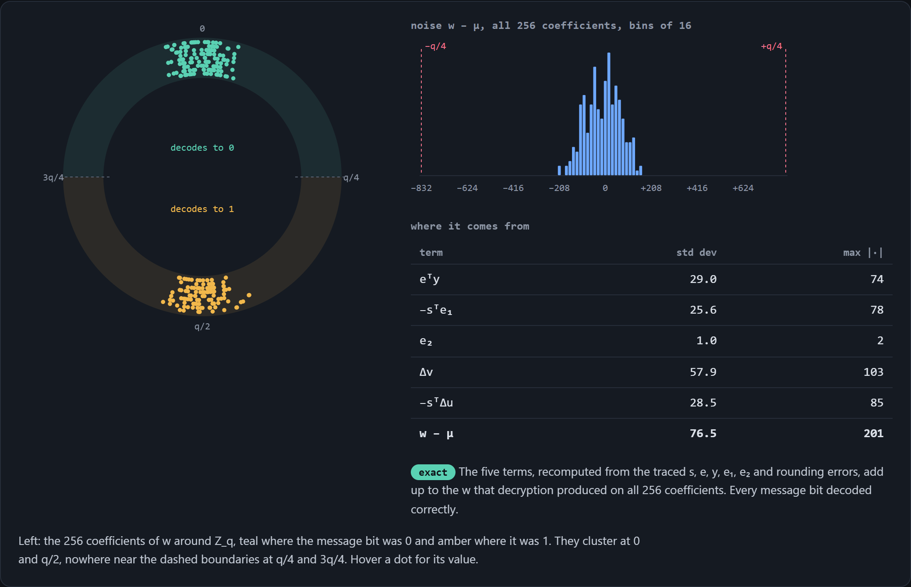
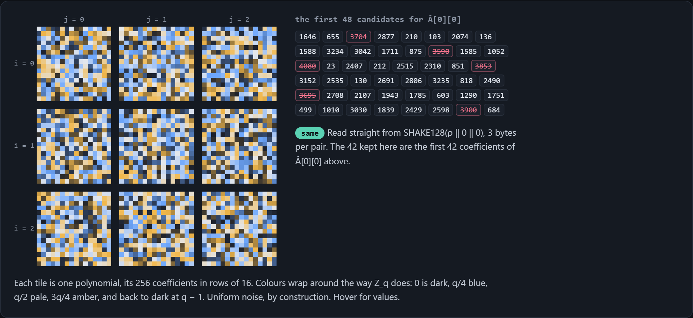
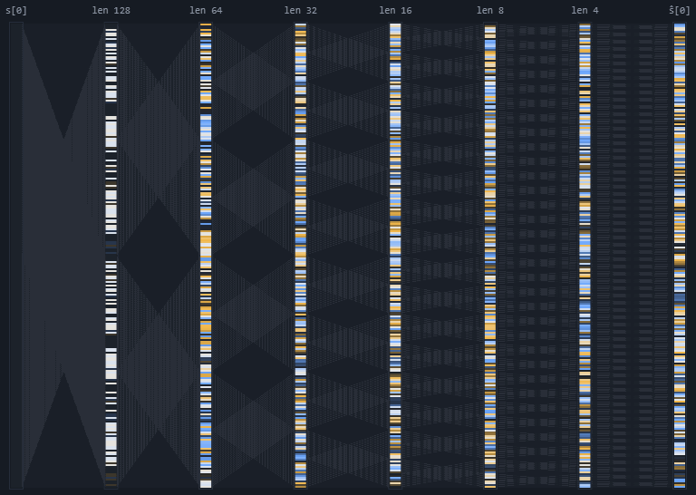
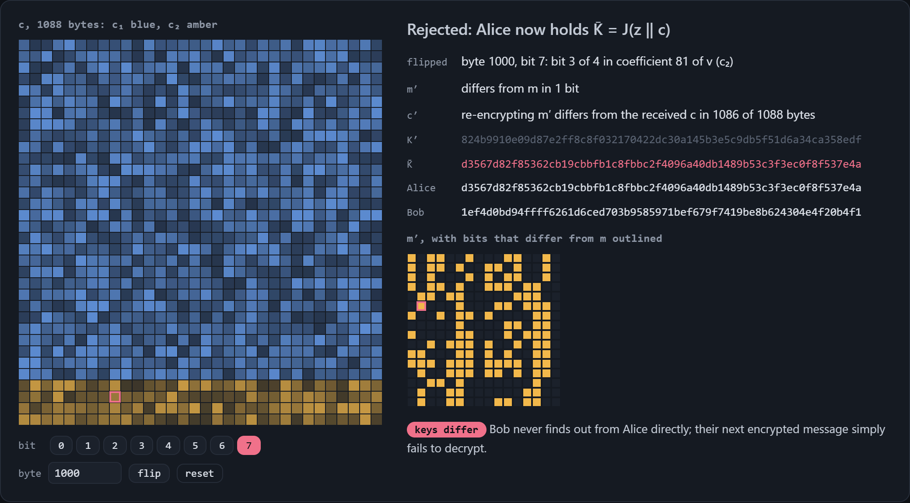

<p align="center">
  
</p>

<h1 align="center">latticework</h1>

<p align="center">
  ML-KEM (FIPS 203, the NIST post-quantum KEM that grew out of Kyber) written from scratch in TypeScript and checked against NIST's own test vectors. It comes with an explainer that runs one real exchange in the browser and draws every intermediate value.
</p>

<p align="center">
  <a href="https://autumntrace.github.io/latticework/"><b>Open the explainer</b></a>
</p>

<p align="center">
  <a href="https://github.com/AutumnTrace/latticework/actions/workflows/ci.yml"></a>
  <a href="https://github.com/AutumnTrace/latticework/actions/workflows/pages.yml"></a>
  
  <a href="LICENSE"></a>
</p>

> [!WARNING]
> This is an unaudited implementation written for learning. JavaScript gives no constant-time guarantees, and this code doesn't try to defend against side channels. See [Security](#security) before using it for anything.

## Why

ML-KEM is already in everyday use: the hybrid X25519MLKEM768 key exchange is on by default in current Chrome and Firefox. The standard that defines it, [FIPS 203](https://doi.org/10.6028/NIST.FIPS.203), is unusually readable: 21 numbered algorithms, most of them a dozen lines long. I wanted to know what actually happens inside it, so I wrote every piece myself, Keccak included, keeping each function next to the algorithm number it implements, and then built a page that shows the numbers.

The library is about 1,200 lines (plus a 288-line generated Keccak permutation) with no runtime dependencies. It runs in Node 20+ and in browsers.

## Using it

```ts
import { mlKem768 } from '@autumntrace/latticework';

// Alice makes a key pair and publishes the encapsulation key.
const { encapsulationKey, decapsulationKey } = mlKem768.keygen();

// Bob encapsulates: he gets a 32-byte secret and a ciphertext to send back.
const { sharedSecret, ciphertext } = mlKem768.encapsulate(encapsulationKey);

// Alice decapsulates the ciphertext and gets the same 32 bytes.
const aliceSecret = mlKem768.decapsulate(decapsulationKey, ciphertext);
```

`mlKem512`, `mlKem768` and `mlKem1024` have the same methods:

| Method                                                                             | Does                                                                                                                                                           |
| ---------------------------------------------------------------------------------- | -------------------------------------------------------------------------------------------------------------------------------------------------------------- |
| `keygen(seed?)`                                                                    | ML-KEM.KeyGen (Algorithm 19). With a 64-byte `seed` (d ‖ z) it is deterministic, which is also the compact way to store a private key.                         |
| `encapsulate(ek)`                                                                  | ML-KEM.Encaps (Algorithm 20), after the encapsulation-key check of section 7.2.                                                                                |
| `decapsulate(dk, c)`                                                               | ML-KEM.Decaps (Algorithm 21), after the length and hash checks of section 7.3. Never fails on a bad ciphertext: it returns the implicit-rejection key instead. |
| `checkEncapsulationKey(ek)`, `checkDecapsulationKey(dk)`                           | The section 7 input checks on their own.                                                                                                                       |
| `keygenInternal(d, z)`, `encapsulateInternal(ek, m)`, `decapsulateInternal(dk, c)` | The deterministic `_internal` algorithms (16 to 18), for test vectors. Each takes an optional trace object that receives the intermediate values.              |

Bad lengths and failed checks throw `MlKemInputError`. Two more entry points: `@autumntrace/latticework/sha3` has SHA3-256, SHA3-512, SHAKE128 and SHAKE256, and `@autumntrace/latticework/internals` exposes the building blocks (NTT, sampling, encodings, K-PKE) under their FIPS 203 names. The internals are not a stable API.

|                        | ML-KEM-512 | ML-KEM-768 | ML-KEM-1024 |
| ---------------------- | ---------: | ---------: | ----------: |
| NIST security category |          1 |          3 |           5 |
| Encapsulation key      |      800 B |    1,184 B |     1,568 B |
| Decapsulation key      |    1,632 B |    2,400 B |     3,168 B |
| Ciphertext             |      768 B |    1,088 B |     1,568 B |
| Shared secret          |       32 B |       32 B |        32 B |

The package isn't published to npm. To use it, clone the repository: the library is `packages/latticework`, and `npm run build` compiles it to `dist/`.

## How it's checked

**NIST's ACVP vectors.** The tests run against the JSON vector sets from [usnistgov/ACVP-Server](https://github.com/usnistgov/ACVP-Server), pinned to release v1.1.0.43 (commit `975de31`). [`scripts/fetch-vectors.mjs`](scripts/fetch-vectors.mjs) downloads them and checks each file's SHA-256 before any test runs. Both encapDecap revisions are covered: the original `FIPS203` and `FIPS203-tr1`, which adds keys handed over as seeds.

| Parameter set | keyGen | encapsulation | decapsulation | ek check | dk check | Total |
| ------------- | -----: | ------------: | ------------: | -------: | -------: | ----: |
| ML-KEM-512    |     25 |            50 |            30 |       20 |       20 |   145 |
| ML-KEM-768    |     25 |            50 |            30 |       20 |       20 |   145 |
| ML-KEM-1024   |     25 |            50 |            30 |       20 |       20 |   145 |

Half of the decapsulation vectors use a modified ciphertext and check the implicit-rejection key. Half of the key-check vectors are invalid keys that must be refused: encapsulation keys with a coefficient ≥ q, and decapsulation keys whose stored H(ek) was changed.

| Hash     | Vectors                                                                                                                          |
| -------- | -------------------------------------------------------------------------------------------------------------------------------- |
| SHA3-256 | 1,194 AFT (1,043 of them with a message that isn't a whole number of bytes) and the Monte Carlo test, 100 × 1,000 chained hashes |
| SHA3-512 | 682 AFT and the Monte Carlo test                                                                                                 |
| SHAKE128 | 269 AFT                                                                                                                          |
| SHAKE256 | 237 AFT (196 asking for an output that isn't a whole number of bytes)                                                            |

The 8 large-data tests (64 GiB messages) are skipped.

**The C2SP/CCTV vectors.** [CCTV](https://c2sp.org/CCTV/ML-KEM) targets failure modes that random vectors reach only by luck. The files are pinned to commit `b88c4b2` and hash-checked by the same fetcher. For each parameter set:

- **strcmp**: a ciphertext that differs from its re-encryption only after a zero byte, so a comparison that stops at `0x00` would accept it. It must be rejected, and the key must be J(z ‖ c).
- **modulus**: encapsulation keys with one unreduced coefficient (775, 780 and 1,040 keys). Between them they cover every value from q to 4095 and every coefficient position. Every key must fail the section 7.2 check, and encapsulation must refuse it.
- **unlucky SampleNTT**: a key whose matrix entry (0, 0) needs more than 575 bytes of SHAKE128 output, which happens by chance with probability about 2⁻³⁸. The test checks that byte count as well as the key, the ciphertext and the shared secret.
- **accumulated**: the 10,000 pseudo-random tests of pq-crystals' `test_vectors.c`, regenerated from a SHAKE128 stream and hashed into a single value. They take about a minute, so `npm test` skips them, and `npm run test:full` and CI run them.

The unlucky and accumulated vectors were made for the FIPS 203 draft. In K-PKE.KeyGen the draft hashed G(d), where the final standard hashes G(d ‖ k), and nothing else differs. Those tests derive their keys the draft's way through `kpkeKeyGenFromSeeds`, which is Algorithm 13 from step 2 on, so everything after that one hash runs as the final standard has it.

**Differential tests** run thousands of random seeds, messages and corrupted ciphertexts through both latticework and [@noble/post-quantum](https://github.com/paulmillr/noble-post-quantum), and compare every key, ciphertext, shared secret and rejection key byte for byte. SHA-3 and SHAKE are compared against @noble/hashes, with input lengths clustered around the 72-, 136- and 168-byte block boundaries.

**Property tests** (fast-check): decapsulation recovers the secret for any seed and message; flipping any one of the ciphertext's bits gives exactly J(z ‖ c); multiplying through the NTT equals schoolbook multiplication mod X²⁵⁶ + 1; the encodings round-trip; compression error stays within its bound.

In total there are 151 unit, vector and property tests (plus the 2 skipped large-data groups) and 6 Playwright tests of the explainer, all run by CI on every push. `npm test` runs 148 of them in about two seconds and leaves the three accumulated runs to `npm run test:full`.

## The explainer

[autumntrace.github.io/latticework](https://autumntrace.github.io/latticework/) runs a complete ML-KEM exchange (512, 768 or 1024) in the page and draws it in eight steps: the seeds, the matrix Â, the noise, the NTT, the key pair, encapsulation, decapsulation, and tampering. The figures don't come from a second, illustrative implementation. The library's own functions take an optional trace object and copy their intermediate values into it, and the page draws those. Where the page makes a claim it can check, it checks it live and shows the result: the NTT product against schoolbook multiplication, the decomposed noise against the decrypted w, the kept SampleNTT candidates against the matrix. "Copy link" puts the seeds and message in the URL, so any run can be reproduced exactly.

<p align="center">
  
</p>

 is never sent: both sides expand it from the 32-byte ρ with SHAKE128, discarding 12-bit candidates of 3329 or more. The panel on the right reads those candidates straight from the XOF and checks that the ones kept are the matrix's first coefficients.

<p align="center">
  
</p>

The NTT drawn on the real values of s[0]. Hovering an output lights up the inputs it depends on. There are always 128 of them, every index of the same parity, because ML-KEM's NTT stops one layer short: 17 is a 256th root of unity mod 3329 but not a 512th.

The image at the top is step 7. In the run the README's pictures come from (fixed seeds, in [`scripts/capture-media.mjs`](scripts/capture-media.mjs)), the largest decryption-noise coefficient is 201, against a decoding threshold of q/4 ≈ 832. The five terms that make it up (eᵀy, −sᵀe₁, e₂, Δv, −sᵀΔu) are recomputed from the trace, and they add up to the observed noise on all 256 coefficients.

<p align="center">
  
</p>

Step 8 lets you flip any ciphertext bit and decapsulate again. "Try all 8,704 single-bit flips" does what it says. For that same fixed exchange, all 8,704 are rejected, and in 6,014 of them (69.1%) decryption still recovered the original message exactly. Only the re-encryption check, comparing ciphertexts rather than messages, catches those.

## Performance

`npm run bench` measures ops/s against @noble/post-quantum 0.7.1. The two libraries run in alternating batches, and each figure is the median of 15 batches. Measured on Windows 11 Pro with an AMD Ryzen 7 9800X3D and Node 24.21.0. The machine wasn't idle, and absolute numbers moved by up to about 20% between runs; the ratio stayed between 1.3× and 1.75×. The raw numbers are in [`bench/results.json`](packages/latticework/bench/results.json).

| Operation              | latticework |   noble | Ratio |
| ---------------------- | ----------: | ------: | ----: |
| ML-KEM-512 keygen      |    14,016/s | 9,855/s | 1.42× |
| ML-KEM-512 encaps      |     8,365/s | 5,736/s | 1.46× |
| ML-KEM-512 decaps      |     9,144/s | 6,481/s | 1.41× |
| ML-KEM-768 keygen      |     8,244/s | 5,529/s | 1.49× |
| ML-KEM-768 encaps      |     5,200/s | 3,342/s | 1.56× |
| ML-KEM-768 decaps      |     4,867/s | 2,794/s | 1.74× |
| ML-KEM-1024 keygen     |     5,678/s | 3,985/s | 1.43× |
| ML-KEM-1024 encaps     |     2,905/s | 1,822/s | 1.59× |
| ML-KEM-1024 decaps     |     2,998/s | 1,840/s | 1.63× |
| SHA3-256, 1 MiB        |    102 MB/s | 57 MB/s |       |
| SHAKE128, 1 MiB output |    127 MB/s | 65 MB/s |       |

Most of the difference is Keccak. The first version used loops over typed arrays and hashed at 21 to 31 MB/s, depending on the run. The permutation now used is generated as straight-line code on 50 local variables ([`scripts/gen-keccak.mjs`](scripts/gen-keccak.mjs)), and a test checks it against the readable loop version on random states. The [devlog](docs/devlog.md) has the before and after.

## Security

This is a learning project. Nobody has audited it. In particular:

- **No constant-time guarantee.** The JavaScript engine decides how arithmetic, comparisons and memory accesses are compiled. The code avoids the obvious mistakes: the ciphertext comparison in decapsulation has no early exit, and the choice between K′ and K̄ is a mask, not a branch. But that's all.
- **Division on secret values.** Compress₁ of the decrypted polynomial divides secret-dependent values by q. In C implementations of Kyber, that pattern was the [KyberSlash](https://kyberslash.cr.yp.to/) timing leak. Here it is a JavaScript division whose timing depends on the engine and the CPU. The NTT's `%` reductions also run on secret coefficients.
- **No zeroization.** Secrets live in ordinary typed arrays until the garbage collector reclaims them.
- **Not FIPS-validated**, and not a substitute for a library that is.

If you need ML-KEM in production, use an audited implementation.

## Layout

```
packages/latticework/      the library
  src/keccak*.ts           Keccak-f[1600] (reference and generated), the sponge
  src/sha3.ts              SHA3-256/512, SHAKE128/256
  src/ntt.ts               R_q arithmetic, NTT, base-case multiplication
  src/encoding.ts          ByteEncode/Decode, Compress/Decompress
  src/sampling.ts          SampleNTT, SamplePolyCBD, PRF
  src/kpke.ts              K-PKE KeyGen/Encrypt/Decrypt, with trace hooks
  src/mlkem.ts             ML-KEM, the input checks, implicit rejection
  test/                    ACVP vectors, differential and property tests
  bench/                   the benchmark above
apps/explainer/            the explainer (Vite, plain TypeScript, canvas and SVG)
e2e/                       Playwright tests of the explainer
scripts/                   vector fetcher, Keccak generator, README media capture
docs/                      how it works, devlog, media
```

## Running it

```sh
npm ci
npm run vectors      # fetch and hash-check the NIST and CCTV vectors (npm test does this too)
npm test             # unit, vector, differential and property tests (about 2 s)
npm run test:full    # the same plus the accumulated CCTV runs (about a minute), as CI runs it
npm run dev          # the explainer at http://localhost:5173/latticework/
npm run build && npm run e2e
npm run bench
npm run media        # regenerate docs/media (uses your installed Chrome)
```

## Roadmap

- **ML-DSA (FIPS 204)**: signatures, reusing Keccak and the same structure for the NTT, over a much larger q = 8,380,417.
- **X-Wing**: the hybrid of X25519 and ML-KEM-768 from the CFRG draft, which needs an X25519 first.
- **The ACVP large-data tests and CCTV's million-test accumulated run**, as a weekly CI job rather than on every push.
- **The explainer on phones.** It works but was laid out for a desktop window.

## Further reading

- [FIPS 203](https://doi.org/10.6028/NIST.FIPS.203), the standard itself. The algorithm numbers in this code refer to it.
- Filippo Valsorda, [Enough Polynomials and Linear Algebra to Implement Kyber](https://words.filippo.io/kyber-math/): the clearest introduction to the maths that I found.
- [docs/how-it-works.md](docs/how-it-works.md): the code walked through against the standard, and how the explainer gets its numbers.
- [docs/devlog.md](docs/devlog.md): what went wrong along the way.

## License

MIT. The ACVP test vectors are produced by NIST and are not subject to copyright in the United States. The CCTV vectors are CC0 1.0. Both are downloaded at test time, not stored in this repository.
